# 🗺️ 500米地图生活圈 (Map Social 500m) - 完整项目知识图谱与架构指引

> **更新时间**：2026-11-11  
> **图谱规模**：**504 个 Nodes** · **803 条 Links** · **24 个功能社区 (Communities)**  
> **构建基准**：Commit `f79cfce` (全量增量提取与社区聚类)  
> **交互式可视化入口**：
> - 🌐 **力导向拓扑全景图 (交互式)**：[`graphify-out/graph.html`](file:///Users/trovant/map/graphify-out/graph.html)
> - 🌳 **层级结构树图谱**：[`graphify-out/GRAPH_TREE.html`](file:///Users/trovant/map/graphify-out/GRAPH_TREE.html)
> - 📊 **Graphify 审计与社区报告**：[`graphify-out/GRAPH_REPORT.md`](file:///Users/trovant/map/graphify-out/GRAPH_REPORT.md)

---

## 🎯 一、功能模块与代码修改快速检索表

当需要迭代、调试或扩展功能时，按照以下核心链路直达目标代码：

| 业务领域 / 模块 | 核心源码文件 (点击跳转) | 关键函数 / 核心响应式状态 | 架构设计与契约约束 |
| :--- | :--- | :--- | :--- |
| **微信底层四大主页签** | [`src/components/common/WeChatTabBar.vue`](file:///Users/trovant/map/src/components/common/WeChatTabBar.vue)<br>[`src/pages/index/index.vue`](file:///Users/trovant/map/src/pages/index/index.vue) | `mainTab` (`map` \| `contacts` \| `chats` \| `me`), `switchMainTab` | 仿微信原生TabBar，带未读消息红点、好友申请徽标与紧急求助红色闪烁 |
| **全局顶栏 (一级导航)** | [`src/components/common/TopNav.vue`](file:///Users/trovant/map/src/components/common/TopNav.vue) | `mapSubTab` (`map` \| `recommend` \| `moments` \| `acgn`), `openPublishSheet` | **一级固定稳重、绝不横移卷动**；右侧微信经典圆形相机 `📷` 节约 52px 空间，4 个 Tab 等宽完美展示 |
| **🌸 二次元同好专区** | [`src/components/feeds/AcgnView.vue`](file:///Users/trovant/map/src/components/feeds/AcgnView.vue)<br>[`src/constants/acgn.ts`](file:///Users/trovant/map/src/constants/acgn.ts) | `selectedCategory`, `filteredStatuses`, `ACGN_TAG_CATEGORIES` | 顶部二级分类单行胶囊横向滑动，下方纵向流独立解耦滚动，配置 `touch-action: pan-y` 彻底杜绝手势死锁 |
| **✨ 同城推荐流** | [`src/components/feeds/RecommendView.vue`](file:///Users/trovant/map/src/components/feeds/RecommendView.vue) | `recommendedStatuses`, `hot-badge` | 综合高赞热评与二次元同好的精选社交动态推荐流 |
| **👥 微信朋友圈流** | [`src/components/feeds/MomentsView.vue`](file:///Users/trovant/map/src/components/feeds/MomentsView.vue) | `sortedMomentsStatuses`, `topEmergencyHelp`, `inPlaceCommentVisible` | 封面大图贴边名片、时间倒序、弹出式赞/评浮层菜单、原地评论条快速回复 |
| **📍 500米地图视图** | [`src/components/map/MapView.vue`](file:///Users/trovant/map/src/components/map/MapView.vue) | `mapCenter`, `mapMarkers`, `mapCircles`, `onMarkerTap` | 500米半透明定位圈、同地点动态聚合点、紧急求助红圈脉冲、高德地图深度去水印 |
| **状态中心 (God Node)** | [`src/composables/useAppState.ts`](file:///Users/trovant/map/src/composables/useAppState.ts) | `useAppState()` (拥有全网最高 83 条依赖边) | 单例状态枢纽：统管弹窗栈、地理定位、数据种子初始化、防穿透点击拦截 |
| **500米范围与聚类算法** | [`src/services/geo.ts`](file:///Users/trovant/map/src/services/geo.ts) | `calculateDistance`, `isWithin500Meters`, `clusterStatusesByLocation` | Haversine 球面大圆距离、35 米内同地点多动态智能聚合计算 |
| **数据持久化与初始种子** | [`src/services/storage.ts`](file:///Users/trovant/map/src/services/storage.ts) | `readLocalData`, `writeLocalData`, `getAcgnStatuses` | 同步+异步本地存储双模支持；预置 7 条真实二次元动态、初始邻居好友与聊天记录 |
| **急事 / 救命 HELP 呼救** | [`src/components/sheets/HelpSheet.vue`](file:///Users/trovant/map/src/components/sheets/HelpSheet.vue) | `isEmergencyHelp`, `submitHelpPost`, `handleCloseHelp` | 双档紧急呼救、一键直拨电话、2 小时自动隐去、发起人结案闭环 |
| **他人资料卡 / 邻居名片** | [`src/components/modals/UserCardModal.vue`](file:///Users/trovant/map/src/components/modals/UserCardModal.vue) | `viewingProfile`, `handleAddFriend`, `startChatFromCard` | 资料弹窗查看他人所有历史动态、直线物理距离展示、加好友与私聊入口 |
| **微信原生全屏灯箱** | [`src/components/modals/ImagePreviewModal.vue`](file:///Users/trovant/map/src/components/modals/ImagePreviewModal.vue) | `previewImageUrls`, `previewImageCurrentIndex` | 支持单图/四宫格/九宫格大图原尺寸高保真手势缩放浏览 |

---

## 🏛️ 二、系统全景架构依赖拓扑图 (Mermaid Architecture)

```mermaid
graph TD
  subgraph 微信主框架基座 [Presentation Layer]
    App["App.vue (100dvh 全局响应式基座)"]
    Index["pages/index/index.vue (主容器路由控制器)"]
    TabBar["WeChatTabBar.vue (微信原生四大底层标签)"]
    TopNav["TopNav.vue (全局稳固顶栏 / 📷相机)"]
  end

  subgraph 首页四大核心视图 [Home Feed Views]
    MapView["MapView.vue<br>📍 500米物理生活圈"]
    RecommendView["RecommendView.vue<br>✨ 同城精选推荐"]
    MomentsView["MomentsView.vue<br>👥 微信朋友圈倒序流"]
    AcgnView["AcgnView.vue<br>🌸 二次元同好空间"]
  end

  subgraph 微信底层二级页面 [Main Tabs]
    ContactsTab["ContactsTab.vue (通讯录与好友管理)"]
    ChatsTab["ChatsTab.vue (微信私聊与群通知)"]
    MeTab["MeTab.vue (个人信息与偏好设置)"]
  end

  subgraph 弹出交互层 [Interactive Sheets & Modals]
    DetailSheet["DetailSheet.vue (动态详情/多级评论)"]
    PublishSheet["PublishSheet.vue (发布动态/坐标打点)"]
    HelpSheet["HelpSheet.vue (紧急求助/救命呼救)"]
    UserCardModal["UserCardModal.vue (他人资料卡/加好友)"]
    MyProfileSheet["MyProfileSheet.vue (资料编辑/隐私设置)"]
    FriendsSheet["FriendsSheet.vue (好友申请管理)"]
    ChatSheet["ChatSheet.vue (独立私聊对话窗)"]
    ClusterSheet["ClusterSheet.vue (同地点聚合列表)"]
    ImagePreviewModal["ImagePreviewModal.vue (图片全屏灯箱)"]
  end

  subgraph 全局状态中枢 [State & Business Logic - God Node]
    UseAppState["useAppState.ts<br>★ 全局核心状态机 (83 edges) ★<br>• mainTab / mapSubTab<br>• visibleStatuses / acgnStatuses<br>• activeHelpStatuses / topEmergencyHelp<br>• openDetailSheet / openPublishSheet"]
  end

  subgraph 领域常数与服务层 [Domain & Service Layer]
    GeoService["geo.ts (Haversine 距离 / 35m 聚合打点)"]
    StorageService["storage.ts (本地存储 / 初始数据种子)"]
    AcgnConstants["acgn.ts (5大分类与标签枚举)"]
    Types["types/index.ts (TypeScript 强类型契约)"]
  end

  App --> Index
  Index --> TabBar
  Index --> TopNav
  Index --> MapView
  Index --> RecommendView
  Index --> MomentsView
  Index --> AcgnView
  Index --> ContactsTab
  Index --> ChatsTab
  Index --> MeTab

  MapView --> UseAppState
  RecommendView --> UseAppState
  MomentsView --> UseAppState
  AcgnView --> UseAppState
  TopNav --> UseAppState
  TabBar --> UseAppState

  DetailSheet --> UseAppState
  PublishSheet --> UseAppState
  HelpSheet --> UseAppState
  UserCardModal --> UseAppState

  UseAppState --> GeoService
  UseAppState --> StorageService
  AcgnView --> AcgnConstants
  StorageService --> Types
```



---

## 🔬 三、Graphify 核心指标与知识网络分析

1. **核心中枢节点 (Top God Nodes)**：
   - `useAppState()`：拥有 **83 条外部依赖边**，作为系统绝对的状态控制中心，连接了所有 View、Sheet 与底层 Storage。
   - `readLocalData()`：拥有 **20 条调用边**，负责 H5 / 小程序双端数据一致性读取。
   - `compilerOptions` & `manifest.json`：支撑跨端 Uni-app 运行基座。
   - `getFriendsList()`：11 条连接边，负责构建邻里关系网。
2. **社区聚类划分 (24 Communities)**：
   - **Community 0 (`useAppState.ts`)**：全局响应式状态集群（67 节点）。
   - **Community 1 (`storage.ts`)**：存储与数据通信网（46 节点）。
   - **Community 16 (`AcgnView.vue` & `acgn.ts`)**：二次元细分流派与专区生态。
   - **Community 20 (`RecommendView.vue`)**：同城推荐过滤与算法排序。
   - **Community 4 (`index.vue`)**：主界面四层挂载拓扑。
3. **依赖闭环与无环断言 (Cycle-Free)**：
   - 全图检测到 **0 个循环依赖 (0 Import Cycles)**，分层遵循单向流动原则（Presentation $\rightarrow$ Composable $\rightarrow$ Service $\rightarrow$ Types）。

---

## 🛠️ 四、后续图谱更新指引

若在后续开发中修改了代码或新增了文件，可随时通过本地命令极速同步图谱：

```bash
# 增量代码更新 (无需消耗 Token，1秒极速重聚类)
graphify update .

# 查询两模块间调用链路 (示例)
graphify path "AcgnView.vue" "useAppState"

# 查看核心架构中枢
graphify god-nodes
```
