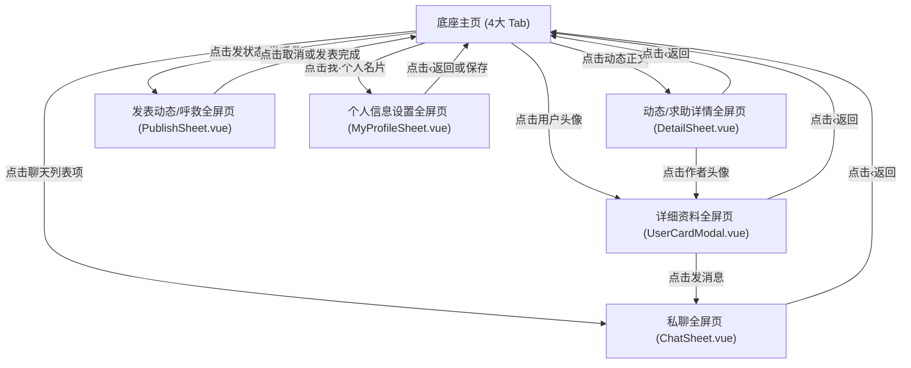
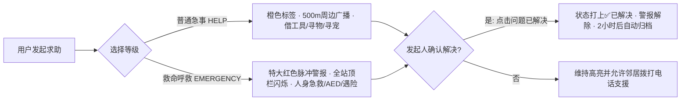

# 500米地图生活圈 · 用户交互手册与开发设计规范

> 本文档为「500米地图生活圈」的核心产品交互逻辑与开发设计规范。后续所有产品功能迭代、UI/UX 改进、架构重构及前后端开发均须严格遵循本规范。

---

## 目录
1. [产品定位与核心设计哲学](#1-产品定位与核心设计哲学)
2. [底层架构与四大主页签体系](#2-底层架构与四大主页签体系)
3. [主视图交互逻辑规范](#3-主视图交互逻辑规范)
4. [全屏二级页面与路由流转规范](#4-全屏二级页面与路由流转规范)
5. [救命呼救与邻里急事求助协议](#5-救命呼救与邻里急事求助协议)
6. [多媒体与全屏大图预览规范](#6-多媒体与全屏大图预览规范)
7. [工程约束与高压红线](#7-工程约束与高压红线)

---

## 1. 产品定位与核心设计哲学

### 1.1 核心价值：超近距离 500m LBS 真实生活圈
- **500米地理围栏**：基于 Haversine 球面大圆算法，以用户当前 GPS 定位为中心，严格计算并过滤展示 500 米范围内的邻友、状态、商户与求助。
- **真实可信社交**：杜绝远程骚扰，聚焦身边看得见的烟火气、邻里互助、周边动态与实时安全。

### 1.2 视觉与交互规范：微信 8.0 原生标准
- **全屏二级流转（严禁浮层弹窗）**：
  - 手机移动端严格遵守原生应用体验。除简短的确认 ActionSheet 外，**所有详情、编辑、个人资料、私聊等次级交互页面必须采用全屏铺满容器（`position: absolute; inset: 0; z-index: 100;`）**；
  - 彻底杜绝桌面式浮动蒙层卡片、杜绝浮动小窗右上角画蛇添足的 `✕` 按钮。
- **色彩规范**：
  - **微信绿** `#07c160`：主要提交操作、激活选中态、求助解决标记；
  - **微信蓝** `#576b95`：用户昵称、位置标签、超链接与查看详情操作；
  - **危险警报红** `#dc2626` / `#ef4444`：救命呼救 (EMERGENCY)、特大警报广播；
  - **背景基底** `#ededed`（顶栏与系统背景）、`#ffffff`（主内容卡片）、`#f7f7f7`（输入框与微信点赞灰框）。

---

## 2. 底层架构与四大主页签体系

应用底部导航栏严格固定为微信标准高度（含 `env(safe-area-inset-bottom)`），四大页签自左至右顺序**严禁擅自调换**：

```
[📍 地图]  ───  [👥 通讯录]  ───  [💬 聊天]  ───  [👤 我]
 (第1位)         (第2位)          (第3位)        (第4位)
```

| 页签 | 图标与状态规范 | 交互目标与承载内容 |
| :--- | :--- | :--- |
| **1. 地图** | 未选：1.8px 优雅线性定位针<br>激活：`#07c160` 填充定位图钉 | 核心地图探索与雷达、顶栏胶囊切换朋友圈 |
| **2. 通讯录** | 未选：1.8px 经典线性双人像<br>激活：分层遮罩微信绿填充双人像 | 500m 圈好友列表、新的朋友、邻友雷达搜索 |
| **3. 聊天** | 未选：1.8px 线性双气泡椭圆<br>激活：绿色填充双气泡（带未读角标） | 邻里 1v1 私聊会话流、最新消息预览与未读管理 |
| **4. 我** | 未选：1.8px 线性单人人像<br>激活：绿色填充人像 | 个人名片展示、求助历史、手机号隐私保护与设置 |

---

## 3. 主视图交互逻辑规范

### 3.1 【地图】页签 (Map Tab)
- **顶栏胶囊切换器 (`TopNav.vue`)**：
  - 提供 `[🗺️ 地图]` 与 `[📰 朋友圈 N]` 双子模态无缝切换；
  - 右侧提供 `📷 发状态` 快捷入口（点击直接调起微信原生全屏发布页）。
- **地图模式 (`MapView.vue`)**：
  - **纯净无水印保障**：高德地图底层 Logo、版权号、缩放水印全部由系统三层拦截隐藏，保持纯净视界；
  - **定位光标**：蓝色呼吸高亮光标指示当前所在经纬度；
  - **500m 围栏圈**：浅紫半透明覆盖层标示生活圈边界；
  - **35米同地点聚合**：35m 范围内的多个状态自动聚合成一个脉冲气泡，气泡展示首发人头像与总条数，点击调起「地点动态全屏页」；
  - **救命求助优先悬浮**：存在未关闭的救命呼救时，地图顶部自动吸顶特大红色警报广播条，点击直达呼救详情。
- **朋友圈模式 (`MomentsView.vue`)**：
  - 纯净无边框社交流，时间倒序排列；
  - 单图按长宽比自适应（最高 240px），4 图呈现 2×2 排版，多图呈现 3 列九宫格；
  - 点击昵称/头像调出「详细资料页」；点击正文进入「动态详情页」；点击图片调出「全屏大图灯箱」。

### 3.2 【通讯录】页签 (Contacts Tab)
- 顶部微信标准搜索栏，支持昵称、手机号模糊检索；
- 功能单元格入口：
  - `新的朋友`：展示待处理的好友申请（带红点角标）；
  - `500米圈邻友雷达`：快速发现周边新发布的邻居；
  - `急事与救命求助`：邻里互助入口；
- 联系人列表按拼音/时间排序，右侧提供直达拨打电话（若公开）与发起私聊。

### 3.3 【聊天】页签 (Chats Tab)
- 微信经典会话列表：展示对方头像、未读红点、最新消息预览与相对时间；
- 点击任意会话项，平滑推入全屏私聊窗口（`ChatSheet.vue`）。

### 3.4 【我】页签 (Me Tab)
- **顶栏严守纯净标准**：居中大字显示“我”，**严禁放置齿轮、设置图标或冗余操作**；
- **个人名片卡片**：展示头像、名字、性别、年龄、邻友号与二维码图标；点击整行直接推入「个人信息全屏页」；
- **求助历史记录**：展示自己发起的求助项及解决状态，点击卡片直接进入详情处理。

---

## 4. 全屏二级页面与路由流转规范

所有二级页面均作为主界面的子组件存在于 `.container` 内部，统一使用 `v-if` 控制显隐，并配置 `position: absolute; inset: 0; z-index: 100;`，确保在桌面端（430px模拟机）及所有手机端完全铺满视口。



### 4.1 动态与求助详情页 (`DetailSheet.vue`)
- **顶栏**：左侧 `‹ 返回`、居中标题（`动态详情` / `急事求助详情` / `救命呼救详情`）、右侧点赞快捷切换（`🤍 点赞` / `❤️ 已赞`）；
- **作者名片行**：头像、昵称（`#576b95`）、性别年龄胶囊、精准相对距离（如 `📍 距离你 85 米`，缺失时优雅降级为 `500米以内`）；
- **急事/救命服务横幅**：若是求助帖，顶部呈现轻量服务通知横幅，发起人专享绿色 `✅ 问题已解决，关闭求助` 按钮，并展示一键拨打电话按钮；
- **点赞名单灰框**：朋友圈经典 `#f7f7f7` 点赞名单，多人逗号分隔；
- **留言流与固定底栏**：贴底输入框、当前回复身份头像、📷 评论配图上传与微信绿发送按钮。

### 4.2 他人详细资料页 (`UserCardModal.vue`)
- **Hero 卡片**：大头像、真实姓名、性别符号、邻友号、地区与相距距离胶囊；
- **功能单元格组**：个性签名展示、手机号行（若对方隐私保护则显示保密状态，若公开则提供一键拨打）；
- **底部核心行动键**：已是好友显示绿色「发消息」；未添加显示「添加到通讯录」。

### 4.3 个人信息设置页 (`MyProfileSheet.vue`)
- 微信原生多组单元格布局（`#ededed` 灰底）；
- 头像行（点击调用手机相册更换）、名字行（输入框）、邻友号与二维码；
- 性别行（点击唤出微信原生底部 ActionSheet：`男` / `女` / `保密`，带选中对勾 `✓`）；
- 手机号绑定与一键隐私加密开关（Switch 开关控制是否对外展示手机号）；
- 顶栏右侧「保存」按钮，保存后自动同步全站本地状态。

---

## 5. 救命呼救与邻里急事求助协议

为确保超近距离安全互助，系统设立严谨的急事求助双档位分级协议：



### 协议规则：
1. **救命呼救优先级最高**：在地图 Marker 上采用特大红圆脉冲动画，全站顶栏自动吸顶；
2. **电话安全与直达**：求助发布必须强制或建议绑定紧急联系电话，提供一键 `uni.makePhoneCall`；
3. **发起人闭环原则**：只有求助发起人有权点击 `✅ 问题已解决，关闭求助`；
4. **平滑淡出机制**：解决后的求助帖保留绿色「已解决」标识供邻里知悉，2 小时后系统自动隐去，保持地图清洁。

---

## 6. 多媒体与全屏大图预览规范

- **全屏沉浸灯箱 (`ImagePreviewModal.vue`)**：
  - 严禁依赖平台差异巨大的 `uni.previewImage` 虚拟路由（在 H5 易引发空白页面或路由错误）；
  - 采用应用内自研全屏大图灯箱组件：纯黑背景（`#000000`）、顶部 `1 / N` 数字指示器、微信原生 `<swiper>` 横向滑动翻页、单击任意空白区域退出。
- **发布图片数量限制**：
  - 普通动态支持 1~9 张图片；求助帖精炼为 1~3 张重点图片。

---

## 7. 工程约束与高压红线

在对本项目进行任何代码修改与重构时，**必须无条件遵守以下工程红线**：

1. **地图水印防穿透红线**：
   - 严禁删除或弱化 `index.html`、`src/App.vue`、`src/components/MapView.vue` 中的高德地图 Logo 与版权号拦截逻辑；
2. **容器边界红线**：
   - 所有全屏二级页面必须挂载在 `.container` 内部，样式遵循 `position: absolute; inset: 0; max-width: 430px;`（移动端 100% 满屏，桌面端自适应居中），严禁页面元素溢出到桌面视口外；
3. **架构与契约红线**：
   - 全局状态统一收敛于 [`src/composables/useAppState.ts`](file:///Users/trovant/map/src/composables/useAppState.ts) 单例中；
   - 外部调用层做好边界默认值容错（如距离为 0 或 undefined 时展示 `500米以内`），业务链路内部充分信任契约保证，杜绝繁琐臃肿的冗余防御分支。
